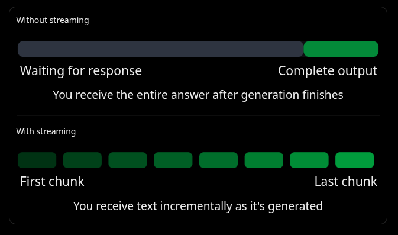

# harness

An harness is a tool that allows you to run and test your AI models in a controlled environment. It provides a framework for setting up experiments, managing datasets, and evaluating model performance. The harness can be used to automate the training and testing process, making it easier to compare different models and configurations.

harness is basically a wrapper/component that allows you to run models in a controlled and desired env.. it's provides a standardized way to run models, and it can be used to automate the training and testing process.. 

I'll build a cli-harness and giving it tools and bash commands.. 


```
multiply(**arguments)  
is equivalent to 
multiply(a=5, b=2)
```



Note: flush=True tells Python to flush the output buffer immediately. This helps make each arriving chunk visible in your terminal. - Helps in Streaming

### What's `yield`: diff between `yield` and `return` in Python?

The core to the point diffrence between `yield` and `return` is that `yield` allows a function to return a value and then pause its execution, allowing it to be resumed later. This is useful for generating a sequence of values over time, rather than computing them all at once.

eg; 
```py 
def nums():
    yield 1
    yield 2
    yield 3

def raw_nums():
    return [1,2,3]

print(list(nums()), raw_nums())

the core diffrence is that using yeild you can resume from where the return leftoff.. 

```

### Async v/s Sync:

- Synchronous (No Async): You have one chef who cooks a meal, walks it out to the table, watches the customer eat it, walks back, and then starts cooking the next meal. The kitchen sits idle while the customer chews.
- Asynchronous: Your chef puts a pancake on the griddle. While the pancake takes 3 minutes to cook (waiting for I/O), the chef doesn't just stand there. They turn around, prep some eggs, or take a new order. They check back on the pancake when it's ready.
