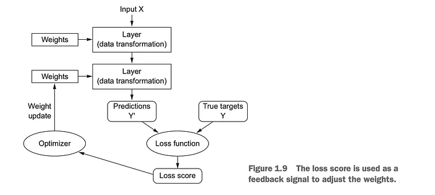
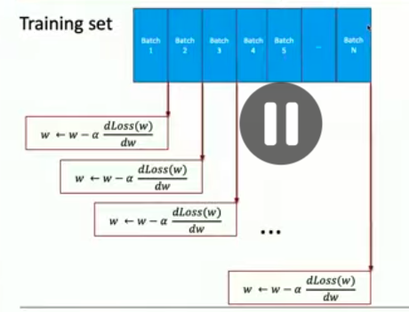

Epoch in GD:
> Epoch is one pass through the full training set - all training data 

one pass -> every data point has passed though the network and we're predicted and calculated the loss and gradient 

$\theta_{t+1} = \theta_t - \alpha \nabla g(\theta_t)$

thus one complete flow at the end we get the gd.. 

## In SGD:
re process in batches(mini-batchs of GD), training data -> create batchs of the training data (batch_1, batch_2...batch_n)

best thing the weights changes with each batch then we do it till the end of all the batchs..

this whole thing is called `Epoch` one end to end 
each of the batch is the n number of rows.. 

How many batch?? well we'll define it: 
thus: 
$N(batches) = \frac{Ndata_points}{batch_size}$

and we ususally choose $N ~ [16,32,64,...]$ as it's very much suitable wit with the hardware we use.. 

thus, the number of updates is the number of batchs we've.. 